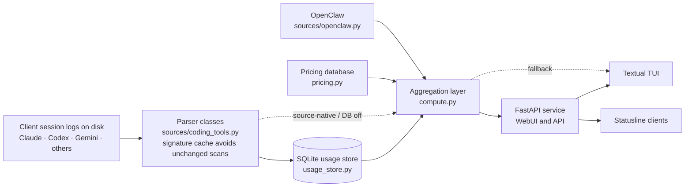

# Architecture and data flow

Tokdash reads local coding-tool activity, stores normalized usage for efficient queries, and presents it through its web and terminal interfaces.

## End-to-end usage flow

## Layers

**Local sources and parsers.** Client applications write session and usage records to local files or their own databases. Parser classes in `coding_tools.py` discover supported formats, normalize usage into entries, and cache file signatures so unchanged inputs do not need to be reparsed on every request. Some parsers are source-native (queried live by `compute.py` on every request), and OpenClaw goes through `sources/openclaw.py` directly. When the usage DB is off or fails, `compute.py` falls back to live parsers.

**Persistent usage store.** `usage_store.py` maintains Tokdash's local SQLite database, including normalized usage entries and source metadata. It synchronizes changed source files and provides indexed queries and aggregation primitives to downstream consumers.

**Pricing.** `pricing.py` and `PricingDatabase` resolve model IDs to per-token rates. Costs are a core output of every view. Most are priced from the pricing database; a few sources keep the cost their client recorded.

**Aggregation.** `compute.py` coordinates parser synchronization, combines stored and source-native data where needed, and calculates date-range usage, costs, and summaries. Its results are the shared data layer used by the presentation surfaces.

**Presentation.** `api.py` exposes usage and quota data through FastAPI routes and serves the WebUI. The Textual TUI first asks a running `tokdash serve` of the same version over HTTP, and only falls back to in-process functions when that fails (`tui/data.py`, `tui/remote.py`). Statusline integrations call `GET /api/usage` for compact usage data.

## Output speed cache

Ordinary usage ingestion does not extract response timing. The Model output speed
page and session speed APIs request a separate worker that builds the disposable
`output_speed.sqlite3` database beside the primary usage database. It stores scalar
measurements and canonical session membership, with atomic publication and
input-scoped failures. Readers display the last successful snapshot while a build
is pending and subscribe to job events only while their page is visible. A model
build reads only the inputs whose usage-store state changed since they were timed,
whatever range the page shows, and leaves a log that is still being written until
it goes quiet.

File readers (Codex, Kimi, omp, dsh, Qwen Code, Claude Code) reparse a whole
contributing log with timing enabled and attach each window to the usage row the
ordinary parser bills; OpenCode, KiloCode and mimo are read from their databases.
Claude Code's reader groups a request's per-block assistant entries by message id
and times it from the first token when a leading thinking block records its
duration, otherwise from the sending user entry up the `parentUuid` chain, keeping
only a per-transcript uuid map. Codex's reader times a response from its marker's
model-item clocks, and falls back to the rollout's line stamps when the marker has
nothing to time: a response that ends in a tool call, or a log before 0.153.

Model and session rates divide summed measured tokens by summed matched duration.
Groups retain source, model, measurement kind and token basis so incompatible
timing windows are not combined. That per-stream rate sits beside a combined one,
which divides the same tokens by the union of busy time, so overlapping responses
count once. `speed_trend.py` rebuilds each busy interval from the stored timestamp
and duration, anchored at the start or end as the source records it (Claude Code
and Codex record where each window opened), and buckets
both rates for the trend view. A model's row merged across harnesses carries only
the combined rate, since its windows may differ in kind. Model/hour results use
bounded process caching keyed by publication revision, filters and local-clock
identity. See
[the API contract](../reference/API.md#get-apioutput-speed),
[configuration](../reference/CONFIG.md) and
[benchmark results](benchmarks/OUTPUT_SPEED.md).

## Quota polling subsystem

Quota tracking runs alongside usage aggregation and stores time-stamped quota snapshots in the same local SQLite usage database. When enabled by the master switch, the poller gathers Codex session-derived quota locally and, with credential-scan consent and provider-specific network consent, reads disclosed local CLI credentials and requests quota from supported providers. The daemon schedules ordinary polls with jitter and can add provider-scoped samples before and after fixed reset boundaries. The WebUI and TUI can trigger manual refreshes via `/api/quota/refresh` and the TUI's `u` key. See [`QUOTA.md`](../reference/QUOTA.md) for the full quota polling design.
